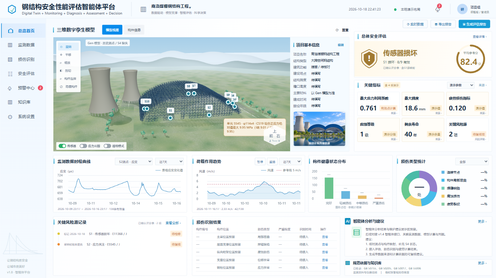

# SteelSafety

**大跨钢结构安全监测与评估工作台 · v1.8**


SteelSafety 基于 Streamlit 与 Three.js，将钢结构 Gen 模型、监测工作簿、材料应力参考评分和待复核风险集中到本地浏览器工作台。本仓库以 v1.8 程序为唯一维护入口，版本号采用 `1.8.0` 格式。



## 功能

| 模块   | 已实现内容                               |
| ---- | ----------------------------------- |
| 三维模型 | 钢结构实体显示、测点定位、构件选择与隐藏、剖切、CS19 静态应力云图 |
| 监测数据 | 多测点应变与温度历史、时间筛选、联动游标、参数风速、CSV 导出    |
| 安全评估 | 已确认评分表与最新监测记录切换、逐点计算、来源说明、评估导出      |
| 关键指标 | 有效测点材料应力比、待复核项统计、现有数据与演示参数切换        |
| 预警中心 | 设备故障、应力复核与缺测清单，计算追溯和模型定位            |
| 知识库  | 资料标题与摘要检索、项目规则、外部来源索引和可选本地原文        |

## 快速开始

需要 **Python 3.10 或以上版本**，推荐 Python 3.12。运行依赖见 [requirements.txt](requirements.txt)；无需 Node.js 即可运行工作台。

```bash
git clone https://github.com/zenghl84/SteelSafety.git
cd SteelSafety
```

**Windows：** 安装 Python 后，双击根目录的 **启动程序.bat**。脚本优先复用已有依赖环境，否则在 `.venv/` 中安装依赖。首次安装需要连接 PyPI。

也可以手动运行：

```powershell
py -3.12 -m venv .venv
.\.venv\Scripts\python.exe -m pip install -r requirements.txt
.\.venv\Scripts\python.exe start.py
```

**macOS / Linux：**

```bash
python3 -m venv .venv
.venv/bin/python -m pip install -r requirements.txt
.venv/bin/python start.py
```

服务仅监听 `127.0.0.1`，默认从 `8501–8520` 中选择可用端口并打开浏览器。保留终端，按 `Ctrl+C` 停止。常用参数：

```bash
python start.py --check                 # 检查依赖与入口资源
python start.py --no-browser            # 仅启动服务
python start.py --port 8502             # 指定端口
```

以上 `python` 指当前虚拟环境中的解释器；不激活环境时请使用其完整路径。

## 项目结构

```text
SteelSafety/
├── app.py                  Streamlit 页面入口
├── start.py                服务启动与环境检查
├── 启动程序.bat            Windows 双击入口
├── VERSION                 版本号
├── requirements.txt        运行依赖
├── requirements-dev.txt    开发检查依赖
├── pyproject.toml          Python 检查配置
├── core/                   模型、监测、评分、预警与页面组装
├── assets/home/            工作台 HTML、CSS、JavaScript
├── assets/viewer/          三维查看器与 Three.js 本地资源
├── data/                   v1.8 模型、监测快照、映射和配置
├── static/knowledge/       资料索引与项目规则
├── docs/                   使用、架构、开发与业务说明
├── scripts/                前端语法检查脚本
├── tests/                  业务和页面集成测试
├── .streamlit/             Streamlit 配置
└── .github/                CI、Issue 与 PR 模板
```

## 数据与当前范围

- 仓库包含 v1.8 使用的项目模型、历史监测工作簿和计算快照。监测曲线不代表实时采集；S4 保持缺测。
- 首页沿用已确认的 **9 点原映射平均参考分 82.4**。S1 已标记传感器损坏，当前有效评分为空；其余 **8 点有效均分为 92.7**。整理目录未修改这些业务口径。
- CS19 应力云图为固定计算快照，模型原始字节通过 SHA-256 校验；它不随监测时间更新。
- 风速由参数生成器产生；挠度、疲劳、腐蚀与剩余年限的演示值均有独立标记，不参与参考评分。损伤识别、全结构鉴定和自动规范问答尚未实现。
- 规范 PDF 和旧字体子集保留为本机可选资料，默认不进入 Git。缺少字体时使用系统字体；未安装的本地原文显示提示，模型、监测和评分仍可运行。见 [本地资料说明](static/knowledge/README.md)。

材料应力参考分用于展示当前项目筛查规则；正式评估仍需结合设计工况、稳定、连接、疲劳和监测方案。详细计算依据见 [业务资料](docs/README.md#业务资料)。

## 开发与文档

```bash
python -m pip install -r requirements-dev.txt
python -m ruff check .
python -m unittest discover -s tests -v
```

安装 Node.js 后可执行 `node scripts/check_frontend.mjs` 检查前端语法。GitHub Actions 配置了 Windows / Ubuntu 与 Python 3.10 / 3.12 的检查矩阵。

- [使用指南](docs/usage.md)
- [架构与数据流](docs/architecture.md)
- [开发与验证](docs/development.md)
- [目录迁移记录](docs/migration.md)
- [更新记录](CHANGELOG.md)
- [参与贡献](CONTRIBUTING.md)

## 许可与资源

项目源码尚未指定开源许可证。Three.js 的 MIT 许可证已保留；字体、规范原文及其他资源的来源范围见 [THIRD\_PARTY\_NOTICES.md](THIRD_PARTY_NOTICES.md)。
