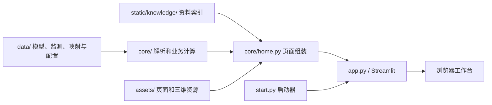

# 架构与数据流

SteelSafety v1.8 是从源码目录运行的 Streamlit 应用。Python 读取模型和工作簿、计算参考结果，再把数据与本地前端资源组装为页面；三维交互和图表在浏览器中运行。

## 模块职责

| 模块 | 职责 |
| --- | --- |
| `start.py` | 依赖检查、端口选择、进程启动、健康检查和关闭清理 |
| `app.py` | Streamlit 配置、资源时间戳缓存和页面嵌入 |
| `core/model.py` | 解析 Gen MGT 节点、单元、材料和截面 |
| `core/viewer.py` | 构造三维场景、读取圆管截面、内嵌 Three.js 资源 |
| `core/monitoring.py` | 读取监测工作簿、保留缺测、沿用原温度修正 |
| `core/assessment.py` | CS18 初值叠加、材料应力参考分、来源与设备状态 |
| `core/key_indicators.py` | 有效应力比、复核项、演示参数和来源说明 |
| `core/alerts.py` | 按数据来源组装设备、应力和缺测风险 |
| `core/resources.py` | 可选字体与本地知识原文可用性 |
| `core/home.py` | 组装页面、监测历史、评估、指标和预警数据 |

## 资源路径与缓存

Python 资源根目录通过 `Path(__file__)` 定位，页面资源相对仓库根目录排列。迁移保留 `core/`、`assets/`、`data/` 和 `static/` 的相对关系。

`app.py` 使用资源文件修改时间作为页面缓存参数，覆盖 Python 模块、数据、页面和知识资源。新增可选 PDF 或字体后重新加载页面或重启服务。三维 JavaScript 在本地打包，不依赖 CDN。

MGT 文件的 SHA-256 必须匹配 `stress_cs19.json` 中的模型哈希。`.gitattributes` 将 `*.mgt` 标记为不进行文本换行转换，避免不同操作系统的 Git 检出改变模型字节。

## 数据状态

历史监测值、CS18 评分初值、CS19 计算云图和演示参数分别保存，各模块显式标记来源。损坏设备保留原记录和参考映射，但退出有效受力统计。

浏览器本地存储用于项目信息、风速参数及页面选择；当前没有数据库、用户账号或远程采集服务。CSV、Markdown 和 JSON 导出由浏览器产生，服务不会把交互修改写回源工作簿。

## 静态资料

Streamlit 开启本地静态服务，`static/knowledge/` 对应 `/app/static/knowledge/`。资料目录可选装 PDF，目录元数据始终可检索；缺少原文时不显示失效的打开链接。
